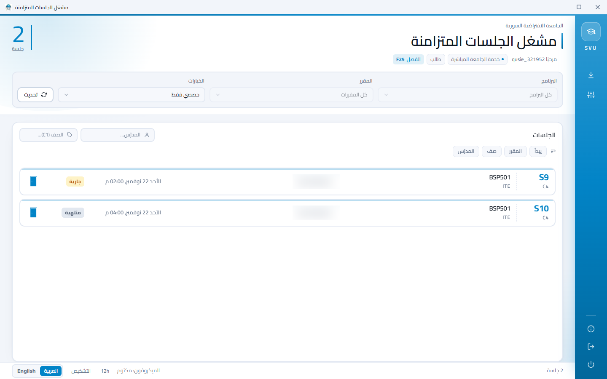

# SVU Sessions Launcher

**Beta 3.0.0-beta.1** - a student-only desktop launcher for Syrian Virtual University online sessions.

This is an unofficial, open-source project. It gives SVU students one Windows app for the
session workflow: sign in, browse programmes and courses, join live sessions, use room chat
and screen sharing, and download recordings. It exists to make those everyday tasks quicker
and less fragmented than moving between browser pages, and to keep the experience consistent
in English and Arabic.

> **Beta software.** The main flows work, but features may change and bugs are expected.
> Feedback, bug reports, and suggestions are welcome on
> [GitHub Issues](https://github.com/qusielh/svu-sessions-launcher/issues). If the project
> is useful to you, please star the repository.

## Download

The latest beta build is on the [Releases](https://github.com/qusielh/svu-sessions-launcher/releases)
page. See [Requirements](#requirements) for the runtimes it needs.

## Screenshots


| English | العربية |
| --- | --- |
|  |  |

The old screenshot has the account name and tutor names redacted. The new screenshots use
sample data.

## Why the launcher was rebuilt

The original launcher was written in 2017 on VB6, the discontinued Microsoft SOAP Toolkit,
and a bundled Java 6 runtime. It worked, but it carried the limitations of that stack. This
version keeps the same university services and session engine while replacing the client
around them.

| | Old launcher (2017) | 3.0.0 beta |
| --- | --- | --- |
| Starting a session | Added a noticeable delay: VB6 started a bundled Java 6 runtime and a WebDemo applet, with no progress while it loaded. | Connects to the room directly and reports each step. |
| Arabic | Bolted onto fixed VB6 controls: clipped text, garbled messages, and locale warnings on some systems. | Full right-to-left layout with the Cairo font, live language switching, and matching English/Arabic text. |
| Window size | Fixed; resizing was disabled. | Resizable main window and viewer, with 1x, 2x, 3x, and Max zoom. |
| Volume | Only the Windows mixer, through a mic-mute checkbox. | Per-session audio with mute and a 0-300% volume slider. |
| Microphone | Switched on by default when joining or starting a session, so an open mic could echo or cut into the tutor's audio. | Muted automatically. The student client never transmits microphone audio, and the status bar reports it muted. |
| Software | VB6, SOAP Toolkit 3.0, Java 6u45 (2013, end of life), a bundled JRE, and a silent system codec install. | .NET 10 and WebView2, with no bundled Java and no silent system installs. |
| Saved credentials | Registry values with weak obfuscation. | Windows DPAPI, current-user scope. |
| Connection loss | No launcher-level recovery; a drop meant rejoining by hand. | Automatic reconnect with a retry budget, offline waiting, and chat kept open. |
| Errors | Raw or missing feedback. | Friendly messages with Retry actions; technical details stay in the log. |
| Theme | Fixed. | Light and dark themes, accent presets, and live re-theming of open windows. |
| Recordings | Not available. | An in-app recording browser with filters, a download queue, progress, and Retry. |

### Other fixes in this beta

- Student microphones are muted automatically. The student client never sends microphone
  audio, so an open mic cannot echo or interrupt the tutor during a lecture.
- Chat stays open through a network drop. The composer disables, the room stays visible, and
  the status line shows "Reconnecting..." instead of failing silently.
- The screen-share viewer keeps its size, supports 2x and 3x even on small screens, and hides
  cleanly when a share ends.
- Downloads show a clear state for every row (Queued, Done, Failed, Cancelled) and can retry
  the exact filter step that failed.
- Theme and accent changes apply immediately to open chat and viewer windows, even when they
  are in the background.
- The session list has proper loading, empty, no-results, and error states, with Retry where
  it makes sense.
- Closing a window that is already closing no longer raises an unobserved exception, and
  failed async commands are logged instead of disappearing.
- English and Arabic stay in parity, and Arabic month names render with Western digits.

## Features

- Sign in with an SVU student account.
- Browse programmes, courses, and sessions.
- Join a student session with the built-in Linktivity client.
- Use room chat and tutor screen sharing.
- Download session recordings.
- Switch between English and Arabic, light and dark themes.

Tutor and host accounts are intentionally blocked in this version. Notifications and private
messaging are not included yet.

## Beta limitations

- This is a student client. The tutor side still needs to be rebuilt before tutor accounts can
  be supported.
- Student microphones are muted by design; there is no student voice channel in this beta.
- Tutor voice still uses the university's TrueSpeech stream, so the TrueSpeech ACM codec is
  required for playback.
- There is no notification system and no private messaging.
- Bugs are expected. Please include the log file and the steps that led to the problem when
  you report one.

## Roadmap

The next improvements depend partly on the university. If SVU is willing to collaborate, some
of these can become official integrations; if not, the project will keep improving them
independently.

- **Move from TrueSpeech to a modern codec such as Opus.** TrueSpeech is old, low quality, and
  only available as a 32-bit Windows codec. Opus would be clearer, smaller, and easier to
  support on modern systems. This needs the university's session service to carry the codec.
- **Rebuild the tutor side.** The student flow is the focus of this beta. A proper tutor
  experience needs host controls, participant management, and the same reliability work.
- **Bring back student voice properly.** Student microphones stay muted for now so nobody can
  echo or cut into the tutor's audio. With SVU's collaboration, voice could return with
  push-to-talk, a moderator mute, and a clear speaking indicator instead of an always-on mic.
- **Add a real notification system.** Session starting, a new screen share, a finished
  download, and connection problems should reach the user even when the launcher is in the
  background.
- **Work with the university, or continue independently.** The launcher is unofficial and not
  endorsed by SVU. Collaboration would make codec and notification changes much easier, but
  the project can continue on its own if that is not possible.

## Requirements

- Windows 10 or Windows 11 (64-bit)
- [.NET 10 SDK](https://dotnet.microsoft.com/download) to build
- [.NET 10 Desktop Runtime](https://dotnet.microsoft.com/download/dotnet/10.0) (x64) to run a prebuilt release
- The .NET 10 Runtime (x86) for tutor voice playback
- Microsoft Edge WebView2 Runtime
- The TrueSpeech ACM codec for tutor voice playback

## Build

```powershell
dotnet build .\SvuSessionsLauncher.slnx -c Release
```

The launcher is written to:

```text
src\SvuSessionsLauncher\bin\Release\net10.0-windows\
```

## Package a release

```powershell
.\build-release.ps1
```

This writes `dist\SVU-Sessions-Launcher-<version>-win-x64.zip` and prints its SHA256.

## Run

```powershell
dotnet run --project .\src\SvuSessionsLauncher\SvuSessionsLauncher.csproj -c Release
```

## Project layout

- `src\SvuSessionsLauncher` - WPF host, WebView2 UI, services, and Linktivity client
- `src\SvuSessionsLauncher\Assets` - login, studio, and chat web assets
- `src\SvuVoiceHelper` - 32-bit TrueSpeech decode and playback helper

## Security

- No API keys, passwords, or tokens are stored in this repository.
- Sign-in credentials are entered by the user; the optional "remember password" store is
  encrypted with Windows DPAPI.
- App state, logs, and saved credentials live under `%APPDATA%` and are not committed.
- The recording archive client uses the university's public page and does not send
  credentials there.

## Credits

- Cairo and Rubik fonts are included under the SIL Open Font License.
- [Microsoft.Web.WebView2](https://learn.microsoft.com/microsoft-edge/webview2/) is used for
  the UI host.

## License

MIT License. See [LICENSE](LICENSE).
