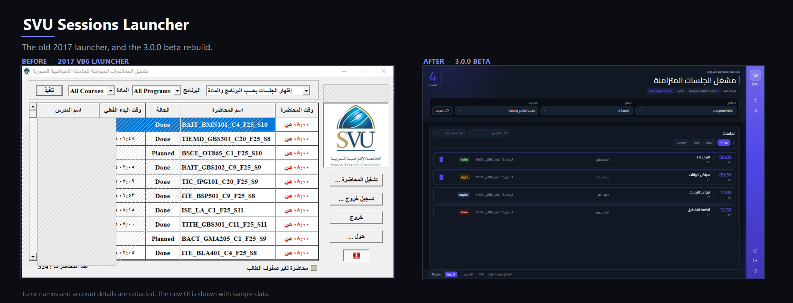
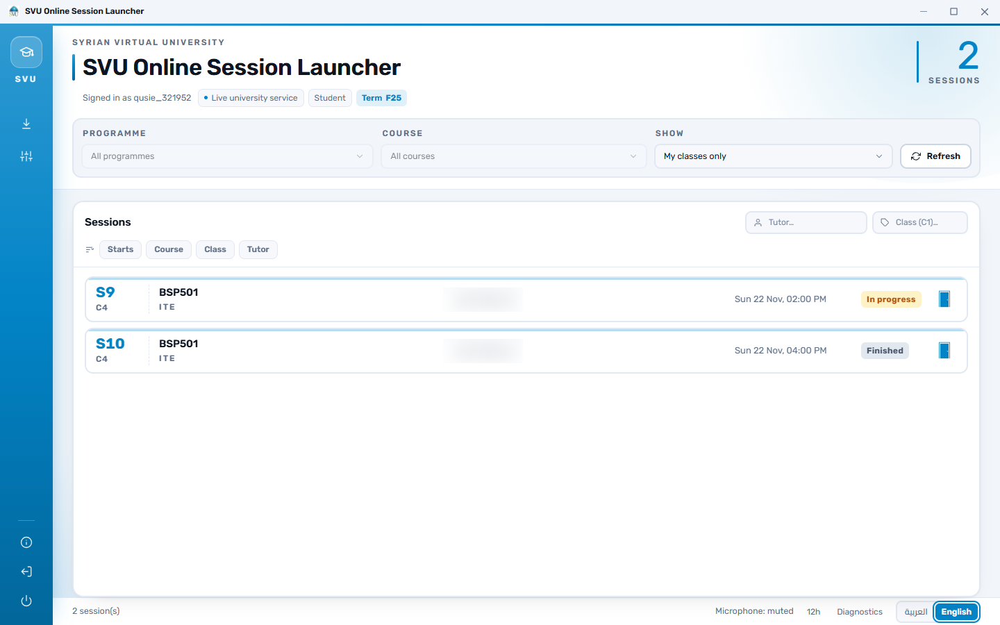
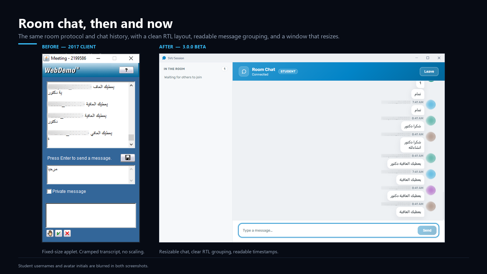

# SVU Sessions Launcher

**Beta 3.0.0-beta.1** — a student-only desktop client for Syrian Virtual University online
sessions.

This is an unofficial, open-source project. It replaces the 2017 launcher with a .NET 10 and
WebView2 app: sign in, browse programmes and sessions, join the live room, use chat and tutor
screen sharing, and download recordings, in English or Arabic. The university's services and the
Linktivity session protocol are unchanged; the client around them is new.

> **Beta software.** The main flows work, but features may change and bugs are expected.
> Feedback, bug reports, and suggestions are welcome on
> [GitHub Issues](https://github.com/qusielh/svu-sessions-launcher/issues). If the project is
> useful to you, please star the repository.

## Download

The latest beta build is on the [Releases](https://github.com/qusielh/svu-sessions-launcher/releases)
page. Choose either asset:

- `SVU-Sessions-Launcher-3.0.0-beta.1-win-x64-setup.exe` - recommended. Installs per user,
  creates Start Menu shortcuts, and includes an uninstaller.
- `SVU-Sessions-Launcher-3.0.0-beta.1-win-x64.zip` - portable. Extract it and run
  `SvuSessionsLauncher.exe`.

The release page lists the SHA256 for both. The installer checks the .NET 10 Desktop Runtime
(x64) and WebView2 before installing; tutor voice also needs the .NET 10 Runtime (x86) and the
TrueSpeech codec. See [Requirements](#requirements).

## Documentation

- [Architecture](docs/architecture.md) - process model, startup, windows, services, and the
  session stack.
- [Code map](docs/code-map.md) - every folder and file, plus a reviewer's reading route.
- [Legacy launcher](docs/legacy-launcher.md) - the 2017 failures, causes, and measured
  comparison.
- [Security and privacy](docs/security-privacy.md) - credentials, local data, logging, and
  transport limits.
- [Release workflow](docs/release-workflow.md) - versioning, packaging, publishing, and patches.
- [Window transitions](docs/window-transitions.md) - the dissolve system in detail.

## Screenshots



| English | العربية |
| --- | --- |
|  |  |

Tutor names are blurred in the launcher screenshots. The old screenshots are the 2017 VB6
client; the new ones show the current 3.0.0 beta.

### Room chat, old and new



The old chat applet was locked to its own small window, with a cramped transcript and no way to
enlarge it. The beta keeps the same room protocol and history, but gives the chat a clean RTL
layout, readable message grouping and timestamps, and a window that resizes with the rest of the
app. Student usernames and avatar initials are blurred in both chat screenshots.

## Why the launcher was rebuilt

The rebuild started from a compiled 2017 client and its installer. There was no source code, no
build script, and no protocol documentation in the package. The new client is an independent
implementation around the same university services and session protocol; it is not a fork and
does not reuse the old source.

The old client worked, but several everyday tasks were slower or harder than they needed to be.
Each section below describes what students saw, why it happened, why it mattered, and what this
beta does instead. The full technical account is in
[docs/legacy-launcher.md](docs/legacy-launcher.md).

### A join took about 21 seconds

In a cold run on the same machine and the same session, the 2017 client took **20.9 seconds**
from the Launch click to the meeting window appearing. The Java process appeared 3.9 seconds
after the click, and there was no useful progress in between. In a separate cold start, the
launcher's first window took 8.5 seconds to appear after the executable started; the join figure
is measured from the Launch click once the app was already open.

The cause was the architecture, not the network. The old client did not join the session itself.
It unpacked and started a bundled Java 6 runtime, loaded a WebDemo applet, and waited for the
applet to initialize, authenticate, and connect. That is a cold JVM start, class loading, and
applet setup on a cold join. VB6 had no structured progress channel back from the applet, so the
window could not say what was happening.

The delay mattered at the start of a lecture. Students joined late, clicked Launch again because
they thought the first click had failed, or gave up and watched the recording later. A
20-second opaque wait is long enough to change what people do.

The new client speaks the Linktivity protocol in-process. There is no JVM and no applet. In the
latest run it completed the join in about **0.2 seconds**; an earlier join over a slower path
took about **6–8 seconds**. The network still sets the floor, but the client no longer adds a
runtime start to it. The chat window opens immediately with a loader, and each retry is visible.

The comparison is join to join: the old client's cold path includes unpacking its bundled
runtime, which is the path on a first run or after a temp cleanup; the new client has no bundled
runtime to unpack. A warm old join would skip the unpack but still start the JVM and applet.

### The window was locked, and the viewer could not scale

The main window was fixed, the chat applet was fixed, and the screen-share viewer was locked to
the broadcast's dimensions and resolution. None of them could be resized, and the viewer could
not upscale or downscale the shared content. A tutor who shared a small window or a
low-resolution slide left students with no way to make it readable.

The cause was fixed pixel layout. The VB6 forms used non-resizable borders, the embedded applet
assumed the same fixed area, and the viewer had no zoom or scale control, so it stayed at the
broadcast's own size.

The shared content is the lecture. If a student cannot read a shared slide or a small
application window, the session has failed at the point that matters.

The beta does not lock the layout. The studio and chat are resizable WPF windows with edge and
corner resizing, per-monitor DPI awareness, and a fluid web layout. The screen-share viewer has
1x, 2x, 3x, and Max zoom and can be enlarged independently of the chat. The goal is to let users
comfortably resize and upscale the viewer rather than restricting them.

### The student microphone broke the tutor's audio

The old client had mute controls. Students could mute themselves, and tutors could force-mute a
student. The failure was around broadcasts: starting a broadcast switched every student
microphone on by default. Tutors had to re-mute students constantly and lost focus on the
lecture.

The student audio path was also broken. It stuttered and produced noise, and that noise turned
the tutor's voice into gibberish for every student in the room. It was not room echo. Mid-session
joins and rejoins triggered it, so one student arriving late could damage the audio for everyone.

The applet owned the session, and the broadcast start reset the room's microphone state. The
client exposed mute and force-mute, but not a way to keep microphones off when a broadcast
began.

A feature that only adds noise is worse than no feature. Tutors spent the lecture policing mutes
instead of teaching, and a single late join could make the tutor unintelligible for the whole
room.

This beta keeps the microphone off by default and never opens a capture device. The status bar
reports it muted. Tutor audio is decoded by the x86 helper and played through `waveOut`; mute and
a 0–300% volume slider apply only to that helper's audio session. The full mute is temporary:
student audio stays off until audio transfer and sharing are split and the university's backend
behavior is understood. `SendVoiceMuteAsync` remains for protocol completeness, not because the
student sends capture audio.

### Recordings required a browser, a second sign-in, and a manual search

To watch a recording, a student left the launcher, opened a browser, signed in to the university
portal, and worked through the recordings page: term, programme, course, tutor, class, then a
result list. The old client had no recordings UI, so this was the only path.

The cause was scope: the original client never implemented the WebForms workflow behind the
recordings page.

The friction was easy to underestimate because it happened after the lecture, when motivation
was lowest. A missed session meant remembering where to go, signing in again, and repeating a
five-step search; a wrong choice produced an empty list with no explanation.

The beta brings the same public recordings page into the app. It keeps the page's cookies and
hidden fields, drives the cascade, and shows a result list with per-row status, progress,
cancellation, retry, and Range-resume downloads. Saved filters are restored on reopen. No
credentials are sent to the recordings page.

### Arabic was bolted on

Arabic text clipped, mixed-direction lines rendered in the wrong order, and some systems showed
locale warnings. English and Arabic did not feel like the same product.

VB6 controls have weak Unicode and bidi support. The layout was built from fixed left-to-right
positions, and the session applet had its own idea of direction. Translation was treated as
replacing strings, not as designing a right-to-left layout.

The interface is where students read session names, tutor names, times, and errors. Clipped
labels and reversed lines made ordinary tasks harder exactly when the student was already
dealing with a problem.

The beta uses HTML/CSS with `dir="rtl"` as a first-class mode, the Cairo font for Arabic, and a
shared font stack that keeps Latin data readable inside Arabic screens. English and Arabic use
matched keys and can switch live; dates use Western digits. Shared column tracks keep the
session table aligned in both directions.

### A dropped connection meant starting over

A network drop ended the session with little explanation, and the student had to close
everything and join again, paying the cold-join cost a second time. Errors were either raw
transport text or nothing at all, so a wrong password, a down server, and a local network
problem looked the same.

The applet owned the connection and the launcher had no retry state machine. VB6 error handling
surfaced SOAP faults directly, with no mapping from fault to user action and no consistent log.

A short Wi-Fi hiccup could cost the rest of a lecture. Students retried blindly or gave up, and
support had little to work with.

The beta keeps the chat window open through a drop, disables the composer, and shows
"Reconnecting..." while a bounded retry loop runs. If all attempts fail, the page gets a Retry
action. Service faults become friendly messages with a known key; technical detail goes to a
sanitized log. The same pattern covers session and download failures.

### Saved passwords were obfuscated, not encrypted

"Remember password" stored the secret in the registry with obfuscation. Any process running as
the same Windows user could recover it. VB6 had no modern secret-storage API in use, and the
design treated obfuscation as protection.

Students reuse passwords, and a shared or infected machine made the exposure real. The beta
encrypts the optional saved password with Windows DPAPI in current-user scope and app-specific
entropy, stores it under `%LOCALAPPDATA%`, keeps only the username in settings, and never writes
the password to the log.

## Not in this beta

These are deliberate choices for this beta, not missing pieces of the student flow.

- **Tutor and host mode.** The 2017 client could host or tutor a session as well as join one.
  This beta blocks tutor and host accounts on purpose: the host controls, participant
  management, and tutor flow need their own rebuild. Pretending the feature never existed would
  be inaccurate; shipping a half-working host mode would be worse.
- **Student voice.** The microphone stays off for now while audio transfer and sharing are split
  and the university's backend behavior is understood. Tutor audio is unaffected.
- **Notifications.** Session start, a new screen share, a finished download, and connection
  problems should reach the student when the launcher is in the background. Not included yet.
- **Private messaging.** Room chat is included; one-to-one messages are not.
- **A modern codec.** Tutor voice still uses the university's TrueSpeech stream. Moving to Opus
  needs the session service to carry it; it is not a client-only change.
- **Account shortcut.** Opening the student account page from inside the app is a small friction
  reducer that is not in this beta.

## Constraints that come from the university

These are not missing features in the client. They are properties of the services the client
must use.

- **Linktivity is not TLS.** The vendor calls its handshake "SSL", but it is a fixed preamble and
  an optional CAST cipher that this client never enables. Session traffic is effectively
  unencrypted. Fixing it requires a protocol change on the university side.
- **The recordings page is plain HTTP.** It is the only published interface. The page is public
  and the client sends no credentials, but a hostile network could observe or alter a download.
- **Tutor voice is TrueSpeech.** The service sends DSP Group TrueSpeech, a 32-bit Windows codec.
  The x86 helper decodes it. The codec is listed in [Requirements](#requirements) instead of
  being installed silently.

## Requirements

- Windows 10 or Windows 11 (64-bit)
- [.NET 10 SDK](https://dotnet.microsoft.com/download) to build
- [.NET 10 Desktop Runtime](https://dotnet.microsoft.com/download/dotnet/10.0) (x64) to run a prebuilt release
- The .NET 10 Runtime (x86) for tutor voice playback
- Microsoft Edge WebView2 Runtime
- The TrueSpeech ACM codec for tutor voice playback

## Build

```powershell
dotnet build .\SvuSessionsLauncher.slnx -c Release
```

The launcher is written to:

```text
src\SvuSessionsLauncher\bin\Release\net10.0-windows\
```

## Package a release

```powershell
.\build-installer.ps1
```

This writes the portable zip, the setup installer, and `SHA256SUMS.txt` to `dist\`. Building the
installer requires [Inno Setup 6](https://jrsoftware.org/isdl.php). Use `.\build-release.ps1` if
you only need the portable zip.

## Run

```powershell
dotnet run --project .\src\SvuSessionsLauncher\SvuSessionsLauncher.csproj -c Release
```

## Project layout

```text
src\SvuSessionsLauncher\        WPF host (.NET 10, x64)
  App.xaml.cs                   startup, services, login -> studio -> session loop
  Assets\                       login, studio, chat pages; shared resize helper; fonts
  Helpers\                      dissolve transitions, snapshots, edge/corner resize
  Linktivity\                   in-process vendor protocol and session engine
  Localization\                 English/Arabic strings and formatting
  Models\                       programme, course, session, and download records
  Services\                     SOAP, catalog cache, credentials, logging, downloads, voice
  Theming\                      theme, accent, header, and ink palettes
  ViewModels\                   studio, sign-in, and downloads state
  Views\                        WPF window hosts for login, studio, chat, viewer
src\SvuVoiceHelper\             32-bit TrueSpeech decode/playback helper
installer\                      Inno Setup script and wizard image
build-release.ps1               portable zip packaging
build-installer.ps1             zip + Inno Setup installer
docs\                           architecture, code map, legacy history, security, releases, images
```

See [docs/code-map.md](docs/code-map.md) for a per-file description and a reviewer's reading
order.

## Security

- No API keys, passwords, or tokens are stored in this repository.
- Sign-in credentials are entered by the user. The optional "remember password" store is
  encrypted with Windows DPAPI in current-user scope and lives under `%LOCALAPPDATA%`.
- Settings, logs, and diagnostic dumps live under `%APPDATA%\SVU Sessions Launcher`; the catalog
  and credential blob live under `%LOCALAPPDATA%\SVU Sessions Launcher`. None are committed.
- Logs are sanitized before they reach disk: URL query strings are stripped, password-shaped
  values and XML password elements are masked, and unknown usernames are redacted. The log
  rotates at 1 MB.
- WebView2 DevTools and default context menus are disabled in the sign-in, studio, and chat
  surfaces. The studio only navigates to local `file:` pages; the chat opens validated
  `http`/`https` links in the default browser.
- There is no telemetry, update checker, or background service. The only outbound traffic is
  what a user action requires.

The transport constraints above and the full data-flow and threat model are in
[docs/security-privacy.md](docs/security-privacy.md).

## Credits

- Cairo and Rubik fonts are included under the SIL Open Font License.
- [Microsoft.Web.WebView2](https://learn.microsoft.com/microsoft-edge/webview2/) is used for
  the UI host.

## License

MIT License. See [LICENSE](LICENSE).
