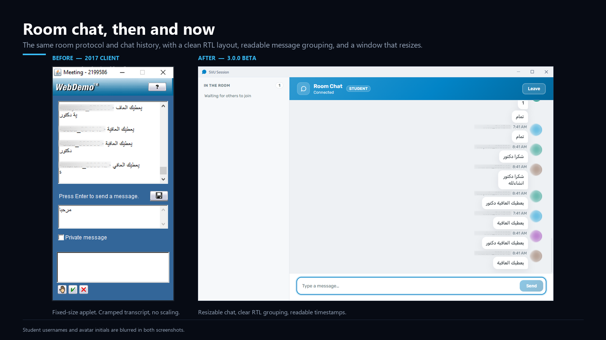

# SVU Sessions Launcher 3.0.0-beta.1

The first public beta of the rebuilt launcher, refreshed with a proper setup installer, a
corrected account of the 2017 client's microphone and resizing failures, and a room-chat
comparison. It replaces the 2017 VB6 client with a .NET 10 and WebView2 app while keeping the
same university services and Linktivity session engine. The version stays at 3.0 so it is
clearly ahead of the university's 2.00.0001 launcher.

The rebuild started from the compiled 2017 client and its installer. There was no source code,
no build script, and no protocol documentation in the package; the new client is an independent
implementation, not a fork. In a cold run on the same machine and session, the old client took
**20.9 seconds** from the Launch click to the meeting window because it started a bundled Java 6
runtime and WebDemo applet. The new client speaks the protocol in-process and completed the join
in about **0.2 seconds** in its latest run; an earlier join over a slower path took about
**6–8 seconds**. The network still sets the floor.

**This is beta software.** The main flows work, but bugs are expected. Please report issues with
the log file and the steps that led to the problem. If the project is useful, a star helps other
students find it.

> This beta asset was refreshed. The setup installer and the portable zip below were rebuilt
> together; the previous zip and checksum were replaced. Download the current assets and compare
> the SHA256 values.

## Room chat, old and new

The 2017 chat applet was locked to its own small window. The transcript was cramped, and the
window could not be enlarged. The beta keeps the same room protocol and history, but the chat is
a normal resizable window with a clean RTL layout, readable message grouping and timestamps, and
the same English/Arabic interface as the rest of the app. Student usernames and avatar initials
are blurred in both screenshots.

## Highlights

- **Installer or portable zip** - install per user with Start Menu shortcuts and a clean
  uninstaller, or extract the zip and run it directly.
- **Arabic that works** - full right-to-left layout, Cairo font, live language switching, and
  matching English/Arabic text.
- **Resizable windows and a real viewer** - the layout is not locked to the broadcast's size, and
  1x, 2x, 3x, and Max zoom let a small or low-resolution screen share be enlarged instead of
  staying unreadable.
- **Per-session audio** - mute and a 0-300% volume slider instead of the Windows mixer.
- **Microphone off by default** - the 2017 client had student mute and tutor force-mute, but
  starting a broadcast switched every student microphone on, and the student audio path could
  turn the tutor's voice into gibberish for the whole room. This beta never opens a capture
  device; the status bar reports it muted. The full mute is temporary while audio transfer and
  sharing are split and the university's backend behavior is understood.
- **Reconnect and offline handling** - chat stays open, the composer waits, and rejoin attempts
  are not wasted while offline.
- **Downloads in the app** - browse recordings, filter, queue, and retry the step that failed,
  without leaving the launcher or signing in to the university portal again.
- **Live themes** - light/dark and accent presets apply to open windows immediately.
- **Safer credentials** - saved passwords use Windows DPAPI.
- **Clear states** - loading, empty, no-results, and error states with Retry actions instead of
  raw failures.

## What changed since the first beta asset

- A setup installer is now published alongside the portable zip. It installs per user, checks
  the .NET 10 Desktop Runtime (x64) and WebView2 before installing, warns about the optional x86
  runtime and TrueSpeech codec, creates Start Menu shortcuts, and uninstalls cleanly.
- The room-chat comparison was added to the README and release notes.
- The microphone history now records what the 2017 client actually did: students could mute
  themselves and tutors could force-mute, but starting a broadcast switched every student
  microphone on, and the student audio path could turn the tutor's voice into gibberish for the
  whole room. The beta keeps the microphone off temporarily while audio transfer and sharing are
  split and the university's backend behavior is understood.
- The resizing history now records that the main window, chat applet, and viewer were locked to
  their own dimensions; the viewer could not upscale or downscale the broadcast. The beta does
  not restrict resizing or zoom.
- Every window state change (open, close, minimize, maximize, restore) now uses one 120 ms
  dissolve. The page and screen share resize once, so transitions no longer stutter. Every edge
  and corner resizes, double-click maximize/restore is immediate, and the sign-in window never
  maximizes.
- The downloads table header is sticky and shares one set of column tracks with its rows, so
  headers and cells keep the same start edge in English and Arabic, with or without a scrollbar.
- GUI chrome text is no longer selectable or copyable; the chat transcript, message text, and
  input fields stay selectable.
- The launch door no longer opens while a session is active or the studio is busy.
- The fixed 980x660 sign-in window never scrolls; the error state compresses the form to fit.
- Downloads keep a term chosen during the initial WebForms load and restore saved filters once.
- Settings, logs, and diagnostic dumps now share one path helper. Logs strip URL queries, mask
  password-shaped values, redact unknown usernames, and rotate at 1 MB. Raw SOAP replies are
  captured only during an explicit diagnostics run.
- WebView2 DevTools and context menus are disabled in all three surfaces, and session logs no
  longer include the username.
- Unused control, microphone, and stream remnants were deleted.
- README and `docs/` now document the architecture, per-file map, the 2017 launcher's failures
  and causes, the measured join comparison, security and privacy limits, the installer and
  release workflow, and the room-chat comparison. The README separates inherited university
  constraints from deliberately deferred work. Screenshots were recaptured from the current app
  with tutor names blurred.

## Install

### Installer (recommended)

1. Download `SVU-Sessions-Launcher-3.0.0-beta.1-win-x64-setup.exe`.
2. Run it. It installs under your user profile, so it does not need administrator rights.
3. Launch from the Start Menu or the final wizard page.

The installer checks for the .NET 10 Desktop Runtime (x64) and Microsoft Edge WebView2 before
installing. It warns if the .NET 10 Runtime (x86) or TrueSpeech codec is missing; those are
needed for tutor voice. The installer is not code-signed, so Windows SmartScreen may warn on
first run.

### Portable zip

1. Download `SVU-Sessions-Launcher-3.0.0-beta.1-win-x64.zip`.
2. Extract it to a folder of your choice.
3. Run `SvuSessionsLauncher.exe`.

Windows 10 or 11 x64 and the Microsoft Edge WebView2 Runtime are required. Install the
[.NET 10 Desktop Runtime (x64)](https://dotnet.microsoft.com/download/dotnet/10.0) before running
the launcher. Tutor voice playback also needs the .NET 10 Runtime (x86) for `SvuVoiceHelper.exe`
and the TrueSpeech ACM codec.

## Inherited constraints

These come from the university's services and the vendor protocol, not from missing client
features.

- Linktivity session traffic uses the vendor's fixed handshake, not TLS. The optional CAST
  cipher is never enabled. This is a limitation of the university's session service; fixing it
  requires a protocol change on their side.
- The recordings page is served over plain HTTP. The client sends no credentials there, but a
  hostile network could observe or alter a download.
- Tutor voice still uses the university's TrueSpeech stream, which requires the 32-bit ACM codec.

## Not in this beta

These are deliberate scope decisions, not limitations.

- **Tutor and host mode.** The 2017 client could host or tutor a session. This beta blocks tutor
  and host accounts because the host controls, participant management, and tutor flow need their
  own rebuild.
- **Student voice.** The microphone stays off for now while audio transfer and sharing are split
  and the university's backend behavior is understood. Tutor audio is unaffected.
- **Notifications and private messaging.** Room chat is included; one-to-one messages and
  background notifications are not.
- **A modern codec such as Opus.** TrueSpeech is the inherited constraint; the session service
  must carry a new codec before the client can use one.
- **Opening the student account page from inside the app**, and similar friction reducers.

## Assets

| File | SHA256 |
| --- | --- |
| `SVU-Sessions-Launcher-3.0.0-beta.1-win-x64-setup.exe` | `52EED03BD40665D899FB69583A98736F970587FE9B22E60DB6E4580D4C13114C` |
| `SVU-Sessions-Launcher-3.0.0-beta.1-win-x64.zip` | `1274DA8E395D5D7FADE681E4C0EA94ECBA386DBB92741910803A3D342E1C1C88` |

The same values are published in `SHA256SUMS.txt`. Compare them after download.

The launcher is unofficial and not endorsed by SVU.

Feedback and bug reports: https://github.com/qusielh/svu-sessions-launcher/issues
